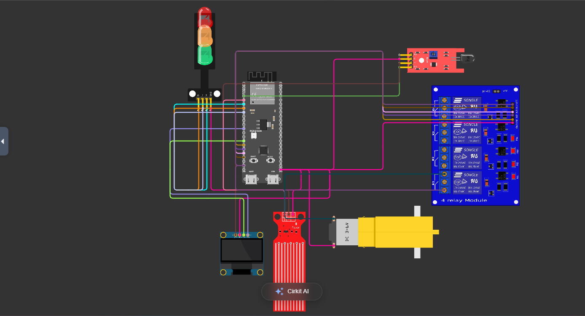
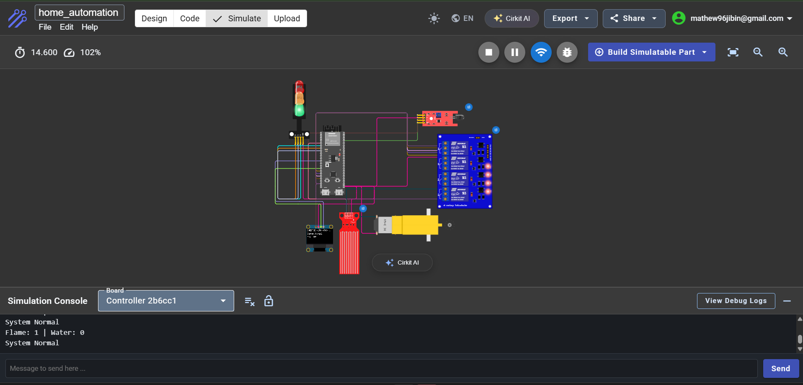

<div align="center">

# ESP32 Home Automation & Safety System

### An ESP32-S3-Based Smart Monitoring and Automated Response Prototype

**Embedded Systems · IoT · Sensor Integration · Automation**


</div>

---

## Overview

This project explores how a microcontroller can monitor environmental conditions and automatically respond to predefined events.

Built around the ESP32-S3, the system integrates flame and water sensors with an OLED display, visual status indicators and a relay-controlled DC motor.

The prototype was developed as a hands-on embedded systems and automation project using Cirkit Designer.

Rather than depending on manual intervention, the system continuously evaluates sensor readings and changes its outputs according to the detected condition.

## Circuit Design



The circuit integrates the ESP32-S3, two sensors, a 128×64 OLED display, a traffic-light indicator, a four-channel relay module and a DC motor.

## Working Simulation



The simulation demonstrates normal system operation, sensor monitoring, OLED updates and serial output.

## Key Features

- Continuous flame and water sensor monitoring
- Automatic response to detected conditions
- Real-time OLED status messages
- Three-color visual status indication
- Relay-controlled DC motor
- Serial Monitor diagnostics
- Flame-detection priority when both sensors are triggered

## System Architecture

```text
       FLAME SENSOR       WATER SENSOR
             |                 |
             +--------+--------+
                      |
                      v
                 ESP32-S3
                      |
          +-----------+-----------+
          |           |           |
          v           v           v
      OLED DISPLAY  INDICATORS  RELAY MODULE
                                  |
                                  v
                               DC MOTOR
```

The ESP32-S3 acts as the central controller. It reads sensor inputs, evaluates the current condition and updates the connected outputs.

## Hardware and Simulation Components

| Component | Quantity | Function |
|---|---:|---|
| ESP32-S3 DevKitC-1 | 1 | Main controller |
| Flame sensor module | 1 | Flame detection |
| Water sensor module | 1 | Water detection |
| 128×64 I2C OLED | 1 | System status display |
| Traffic-light module | 1 | Visual status indication |
| Four-channel relay module | 1 | Switching control |
| DC motor | 1 | Simulated actuator |
| Jumper wires | As required | Circuit connections |

The traffic-light module and DC motor are simulation substitutes for the RGB indicator and fan considered in the original hardware design.

## GPIO Configuration

| Component | Signal | ESP32-S3 Pin |
|---|---|---|
| Flame sensor | DO | GPIO 4 |
| Water sensor | SIG | GPIO 5 |
| Red indicator | Red | GPIO 6 |
| Green indicator | Green | GPIO 7 |
| Yellow indicator | Yellow | GPIO 15 |
| OLED | SDA | GPIO 8 |
| OLED | SCL | GPIO 9 |
| Relay module | IN1 | GPIO 10 |
| Relay module | IN2 | GPIO 11 |
| Relay module | IN3 | GPIO 12 |
| Relay module | IN4 | GPIO 13 |

The OLED communicates through I2C.

Relay channel 1 controls the DC motor through its switching contacts. The motor is not driven directly by an ESP32 GPIO.

All connected modules require appropriate power connections and a common ground.

## Operating Logic

The controller continuously reads both sensors and selects one of three operating states.

| Condition | Indicator | OLED Message | Relay 1 |
|---|---|---|---|
| Normal | Green | System Normal | OFF |
| Flame detected | Red | FLAME DETECTED | ON |
| Water detected | Yellow | WATER DETECTED | ON |

### Normal State

When no hazard is detected, the system activates the green indicator, displays the normal status on the OLED and keeps the motor switched off.

### Flame Detection

When the flame sensor is triggered, the system activates the red indicator, displays a flame warning and energizes relay channel 1.

Flame detection has priority over water detection in the current program.

### Water Detection

When water is detected without an active flame warning, the system activates the yellow indicator, displays a water warning and energizes relay channel 1.

The Serial Monitor continuously reports sensor readings and operating status.

## Software and Tools

- Arduino C++
- ESP32 Arduino Core
- Cirkit Designer
- Visual Studio Code
- Adafruit GFX Library
- Adafruit SSD1306 Library
- Wire Library

## Repository Structure

```text
ESP32-Home-Automation-Safety-System/
|
|-- circuits/
|   |-- circuit.png
|   |-- simulation.png
|
|-- doc/
|
|-- src/
|   |-- home_automation.ino
|
|-- README.md
```

## Running the Project

1. Open the circuit design in Cirkit Designer.
2. Open `src/home_automation.ino` to inspect the firmware.
3. Ensure the required Arduino and Adafruit libraries are available.
4. Configure the ESP32-S3 and connected components according to the GPIO table.
5. Run the simulation.
6. Observe the OLED, indicators, relay and Serial Monitor.
7. Trigger the sensors to test the programmed responses.

The screenshots document the completed circuit and a working simulation. A public Cirkit project link can be added to make the simulation directly accessible.

## Testing and Results

The Arduino sketch compiled successfully for the ESP32-S3.

The simulation was run in Cirkit Designer, with the Serial Monitor confirming continuous sensor readings and normal system operation.

The programmed control logic includes separate responses for flame detection and water detection.

This repository documents a simulation prototype. It does not represent a validated physical safety system.

## Future Development

- ESP32 Wi-Fi connectivity
- Mobile monitoring dashboard
- Remote actuator control
- Real-time notifications
- Physical hardware implementation
- Additional sensor testing and fault handling

## Project Scope

This project was developed as a practical learning exercise in embedded programming, circuit simulation, sensor interfacing and automation.

It is an educational prototype and must not be used as a certified fire detection, flood prevention or emergency response system.

## Author

**Jibin B Mathew**

B.E. Robotics and Automation

[GitHub](https://github.com/JibinMathewB) |
[LinkedIn](https://www.linkedin.com/in/jibinmathew5/)
